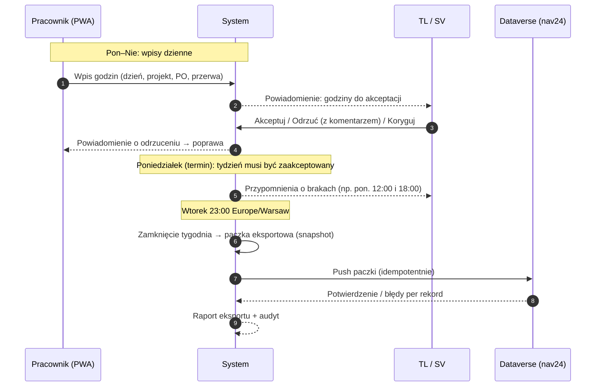
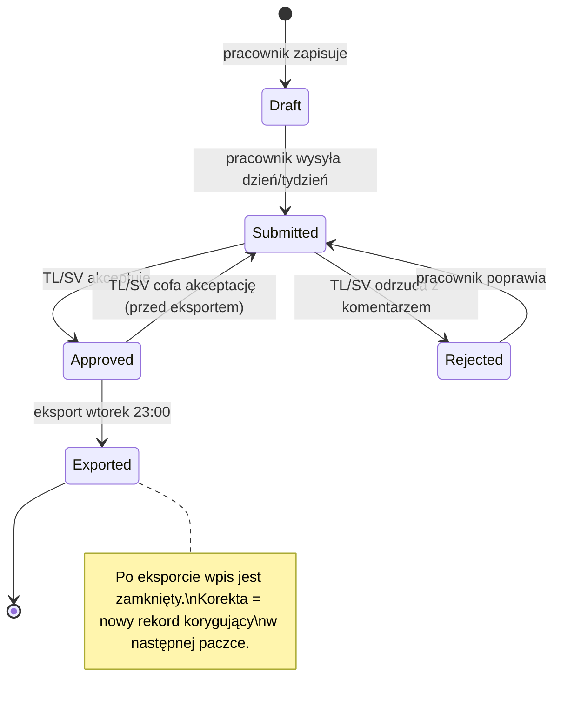
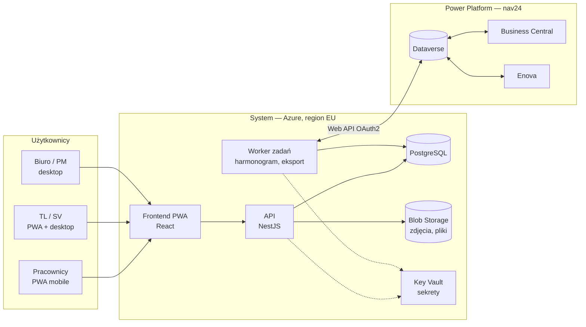
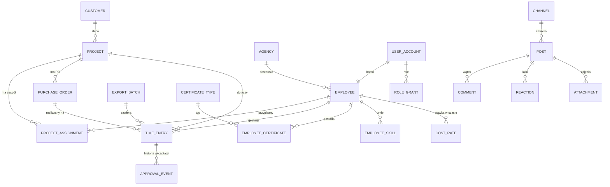

# System rejestracji czasu pracy i zarządzania projektami — Plan działania i architektura

> **Status:** v0.1 — dokument roboczy (draft do dyskusji w zespole)
> **Właściciel:** [Twoje imię] · **Zespół:** [Ty], Valery, Jakub
> **Data:** 2026-10-15
> **Nazwa robocza systemu:** `TBD` (do ustalenia — w dokumencie: „System”)
> **Cel dokumentu:** jedno źródło prawdy o celu, zakresie, architekturze, technologii, procesie wytwarzania i otwartych kwestiach. Dokument żyje w repozytorium (`/docs`) i jest aktualizowany razem z kodem.

---

## Spis treści

1. [Kontekst i cel](#1-kontekst-i-cel)
2. [Zakres: co System robi, a czego nie](#2-zakres)
3. [Użytkownicy i role](#3-użytkownicy-i-role)
4. [Moduły funkcjonalne](#4-moduły-funkcjonalne)
5. [Kluczowy proces: tygodniowy cykl czasu pracy](#5-kluczowy-proces-tygodniowy-cykl-czasu-pracy)
6. [Architektura](#6-architektura)
7. [Stos technologiczny i uzasadnienie](#7-stos-technologiczny)
8. [Integracja z Dataverse](#8-integracja-z-dataverse)
9. [Model danych (wstępny)](#9-model-danych-wstępny)
10. [Bezpieczeństwo i RODO](#10-bezpieczeństwo-i-rodo)
11. [Logowanie zmian — dane i kod](#11-logowanie-zmian)
12. [Proces wytwarzania i dokumentacji](#12-proces-wytwarzania-i-dokumentacji)
13. [UI/UX — podejście](#13-uiux)
14. [Roadmapa](#14-roadmapa)
15. [Ryzyka](#15-ryzyka)
16. [Otwarte pytania](#16-otwarte-pytania)
17. [Słownik](#17-słownik)
18. [Załączniki: szablony ADR, changelog, PR](#18-załączniki)

---

## 1. Kontekst i cel

### 1.1 Sytuacja obecna
- Epcido używa systemu **Gantbee** (planowanie, rejestracja czasu, projekty). System jest niestabilny, ma błędy i jest trudny w rozwoju. Zespół nie ma dostępu do jego kodu ani bazy danych.
- Gantbee wymienia dane z **Dataverse** (Microsoft Power Platform), administrowanym przez **nav24**. Przez Dataverse godziny pracy trafiają do **Business Central (BC)** i **Enovy**.
- W Enovie zakładani są nowi pracownicy (numer pracownika i dane kadrowe).
- Główny ból: **brak przejrzystości („nic nie wiadomo”) i błędy działania systemu.**

### 1.2 Cel
Zbudować od zera nowoczesny, bezpieczny i tani w utrzymaniu system, który:
1. **Zastąpi Gantbee** w zakresie rejestracji i akceptacji czasu pracy oraz zarządzania projektami z perspektywy PM/SV/TL.
2. **Poprawnie wymienia dane z Dataverse** — w co najmniej takim samym zakresie jak Gantbee.
3. Daje pracownikom **aplikację mobilną (PWA)** do wpisywania godzin oraz **tablicę ogłoszeń / komunikator** (wątki, wiadomości, reakcje, zdjęcia).
4. Ma **pełny audyt zmian** (kto, co, kiedy, z jakiej wartości na jaką).
5. Jest **dobrze udokumentowany** od pierwszego dnia.

### 1.3 Założenia wejściowe (z rozmowy)
| # | Założenie |
|---|---|
| Z1 | Budujemy własny system, nie kupujemy gotowego. IBA nie jest brany pod uwagę. |
| Z2 | Gantbee prawdopodobnie zostanie całkowicie wyłączony. Nie wzorujemy się na nim technicznie. |
| Z3 | Projekt realizowany poza Eltronic, we współpracy z nav24 (Dataverse / Power Platform). |
| Z4 | Brak budżetu na tym etapie → **minimalny koszt** utrzymania, bez licencji per użytkownik. |
| Z5 | Skala: **~500 pracowników**, w tym ~50 biurowych i ~30 TL/SV. |
| Z6 | Brak dostępu dla partnerów zewnętrznych (agencje). |
| Z7 | Uprawnienia na start proste, ale model musi pozwalać je później rozbudować. |
| Z8 | Reguły prawne per kraj (limity dni, płaca minimalna) — **poza zakresem na teraz**. |
| Z9 | Typy zatrudnienia: **B2B, UoP, pracownicy z agencji**. System to przede wszystkim **rejestr czasu pracy**. |
| Z10 | Budują 3 osoby. Po MVP — prezentacja zarządowi. |
| Z11 | Sposób migracji danych z Gantbee nieustalony. |

---

## 2. Zakres

### 2.1 W zakresie (z dokumentu ERP Fase 1 — wybrane potrzeby PM/PMO/Installation)
- Projekty: dane podstawowe, klient, lokalizacja/adres, numery PO, przypisany PM.
- Zespół projektu: hierarchia **SV → TL → pracownicy**, rezerwacja zespołu z wyprzedzeniem.
- Rejestracja czasu: dzienne godziny, podział na PO, przerwy, typ absencji.
- Akceptacja godzin przez TL/SV z logiem „kto zaakceptował”.
- Tygodniowy eksport do Dataverse (wtorek 23:00).
- Widok tygodniowy wszystkich projektów (forma do dopracowania).
- Skill matrix: certyfikaty z datami ważności, umiejętności, filtrowanie pracowników.
- Koszty projektu: koszt pracy wg typu umowy i stawek (godziny × stawka), później inne koszty.
- Raporty: godziny per pracownik / projekt / klient, nadgodziny, eksport do Excela.
- Widoczność absencji i zmian (dzień / późna / noc) na osi czasu projektu.
- Lokalny kalendarz świąt per lokalizacja projektu.
- PWA dla pracowników: wpis godzin, tablica ogłoszeń, wątki, wiadomości, reakcje, zdjęcia.
- Powiadomienia (np. „przypisano Cię do projektu”, „godziny do akceptacji”).

### 2.2 Poza zakresem (na teraz)
- Reguły prawne per kraj i alerty limitów (Z8) — model danych je przewiduje (kraj pracy per wpis), logika później.
- Logistyka/Travel, Tools, HSE (poza ogłoszeniami), Recruitment, Tender, Finance (poza eksportem godzin).
- Dostęp dla partnerów zewnętrznych.
- RCP sprzętowe (bramki, czytniki). Skan QR/kodu kreskowego w projekcie to opcja na później.
- Planowanie budżetu rocznego i forecast 12 tygodni.

---

## 3. Użytkownicy i role

| Rola | Liczba (ok.) | Kanał | Co widzi / robi |
|---|---|---|---|
| **Pracownik (site)** | ~420 | PWA (telefon) | Okrojony panel: wpis dziennych godzin w swoich projektach, swoja historia, tablica ogłoszeń, wiadomości. |
| **Team Leader (TL)** | ~30 łącznie z SV | PWA + desktop | Wszystko w projektach, do których jest przypisany. Akceptacja / odrzucenie / korekta godzin. |
| **Supervisor (SV)** | (w puli ~30) | PWA + desktop | Jak TL + skład zespołu, zarządzanie TL. |
| **Biuro: PM / Planning / PMO** | ~50 | Desktop | Projekty, przypisania, widok tygodniowy, skill matrix, koszty, raporty. |
| **Administrator** | 1–3 | Desktop | Użytkownicy, role, słowniki, integracja, podgląd audytu. |

### 3.1 Model uprawnień — prosto teraz, elastycznie później
- **RBAC** (role → uprawnienia), a nie sztywne `if role == 'TL'` w kodzie. Uprawnienia to nazwane akcje, np. `time_entry.approve`, `project.edit`, `cost.view`.
- **Zakres (scope)**: uprawnienie działa w zakresie `global` albo `project` (wynikającym z przypisania do projektu). Dzięki temu TL widzi „wszystko”, ale tylko w swoich projektach.
- Role i ich uprawnienia trzymane w bazie → admin może je później zmieniać bez wdrożenia.
- Na start 5 ról z tabeli powyżej. Uprawnienie `cost.view` domyślnie tylko dla biura (do decyzji, czy TL/SV widzą koszty).

---

## 4. Moduły funkcjonalne

| Moduł | Opis | Etap |
|---|---|---|
| **M1 Tożsamość i dostęp** | Logowanie, MFA, role, sesje, zaproszenia | MVP-1 |
| **M2 Pracownicy** | Kartoteka synchronizowana z Dataverse (nr Enova), typ umowy, agencja, status | MVP-1 |
| **M3 Projekty** | Klient, lokalizacja, kraj, PO, PM, daty, status | MVP-1 |
| **M4 Przypisania / zespół** | SV/TL/pracownik per projekt z zakresem dat; później tablica „jak Miro” | MVP-1 (lista), MVP-2 (tablica) |
| **M5 Rejestracja czasu** | Wpis dzienny, podział na PO, przerwy, absencje | MVP-1 |
| **M6 Akceptacja** | Workflow akceptacji, korekty, blokada tygodnia | MVP-1 |
| **M7 Eksport do Dataverse** | Tygodniowy push, idempotentny, z raportem | MVP-1 |
| **M8 Audyt** | Historia każdej zmiany danych | MVP-1 (od dnia 1) |
| **M9 Przegląd tygodniowy** | Widok wszystkich projektów: kto, gdzie, ile godzin, status akceptacji | MVP-2 |
| **M10 Skill matrix** | Certyfikaty, daty ważności, umiejętności, filtry, alerty wygasania | MVP-2 |
| **M11 Koszty projektu** | Stawki z historią obowiązywania, koszt pracy per projekt / tydzień / typ umowy | MVP-2 |
| **M12 Raporty i eksport Excel** | Godziny per pracownik/projekt/klient, nadgodziny, absencje | MVP-2 |
| **M13 Tablica ogłoszeń i komunikacja** | Kanały (firma, projekt), wątki, komentarze, reakcje, zdjęcia, wiadomości prywatne, potwierdzenia przeczytania | MVP-3 |
| **M14 Powiadomienia** | In-app + Web Push (PWA) + e-mail | MVP-1 (podstawowe), rozwijane |
| **M15 Planowanie / Gantt / zmiany** | Oś czasu projektu, absencje, zmiany, rezerwacje | Po MVP |

---

## 5. Kluczowy proces: tygodniowy cykl czasu pracy

To serce Systemu. Musi działać bezbłędnie, bo od niego zależą wynagrodzenia (Enova) i fakturowanie (BC).

### 5.1 Przebieg


### 5.2 Statusy wpisu czasu


### 5.3 Reguły (do potwierdzenia)
- Tydzień = poniedziałek–niedziela, strefa czasowa **Europe/Warsaw** (uwaga na zmianę czasu letni/zimowy — harmonogram liczony w strefie, nie w UTC).
- Termin akceptacji: **poniedziałek** (godzina do ustalenia, np. 23:59).
- Eksport: **wtorek 23:00**, cały poprzedni tydzień.
- **Po eksporcie wpisów nie edytujemy.** Korekta tworzy rekord korygujący (+/- godziny), który trafia do kolejnej paczki. Dzięki temu Dataverse/Enova/BC zawsze mają spójną historię.
- Eksport jest **idempotentny**: każdy rekord ma stały identyfikator zewnętrzny. Ponowne wysłanie nie tworzy duplikatów.
- Każda paczka ma numer, sumy kontrolne (liczba rekordów, suma godzin) i raport sukcesów/błędów.
- **Otwarte:** co z wpisami niezaakceptowanymi w terminie (pominąć i wysłać później / auto-akceptacja / blokada eksportu całości)?

---

## 6. Architektura

### 6.1 Zasada główna
**Modularny monolit** w jednym repozytorium (TypeScript end-to-end), z wyraźnymi granicami modułów. Dla 3-osobowego zespołu i ~500 użytkowników mikroserwisy byłyby tylko kosztem. Granice modułów pozwolą później wydzielić np. komunikator do osobnej usługi, jeśli zajdzie potrzeba.

### 6.2 Dlaczego nie Power Apps
Jesteśmy w ekosystemie Power Platform, więc naturalnym pytaniem jest stworzenie systemu w Power Apps. Rekomendacja: **nie**, z powodów:
- **Licencje per użytkownik** dla ~500 osób byłyby dominującym kosztem (sprzeczne z Z4). Do weryfikacji z nav24 aktualnego cennika i ewentualnych licencji, które już macie.
- Ograniczona kontrola nad UI/UX — a ten ma być dokładnie dopracowany.
- Funkcje „social” (wątki, reakcje, zdjęcia, real-time) są w Power Apps trudne i drogie.
- Słabsza kontrola wersji, przeglądów kodu i testów niż w klasycznym repozytorium.

Dataverse pozostaje **punktem integracji** (System ↔ BC, Enova), a nie bazą aplikacji.

### 6.3 Diagram kontekstowy


### 6.4 Komponenty
| Komponent | Odpowiedzialność |
|---|---|
| **Frontend (PWA)** | Jedna aplikacja, responsywna: widok „pracownik” (mobile-first) i „biuro” (desktop). Instalowalna na telefonie, Web Push, cache offline dla podglądu. |
| **API** | Logika biznesowa, autoryzacja, walidacja, audyt. REST + OpenAPI (automatyczna dokumentacja). |
| **Worker** | Zadania w tle: eksport tygodniowy, synchronizacja pracowników z Dataverse, przypomnienia, powiadomienia, przetwarzanie zdjęć. Ten sam kod co API, osobny proces. |
| **PostgreSQL** | Jedyna baza aplikacji: dane, audyt, kolejka zadań. |
| **Blob Storage** | Zdjęcia i załączniki, prywatne, dostęp przez krótkotrwałe podpisane linki. |
| **Key Vault** | Sekrety i certyfikat do Dataverse. Zero sekretów w kodzie i repozytorium. |

### 6.5 Struktura modułów w kodzie
```
apps/
  web/                 # frontend PWA (React + Vite)
  api/                 # backend (NestJS): HTTP + worker (osobny entrypoint)
    src/modules/
      identity/        # M1
      employees/       # M2
      projects/        # M3, M4
      time/            # M5, M6
      integration-dataverse/  # M7
      audit/           # M8
      skills/          # M10
      costs/           # M11
      reports/         # M12
      social/          # M13
      notifications/   # M14
packages/
  shared/              # wspólne typy i schematy walidacji (Zod) frontend+backend
  ui/                  # design system (komponenty)
  config/              # wspólna konfiguracja ESLint/TS
docs/                  # ten dokument, ADR, runbooki
infra/                 # Infrastructure as Code (Bicep/Terraform)
```
Moduły komunikują się przez jawne serwisy/zdarzenia domenowe, nie przez bezpośredni dostęp do cudzych tabel.

---

## 7. Stos technologiczny

Kryteria wyboru: **bezpieczeństwo, niski koszt, mały zespół, jeden język, dojrzałe narzędzia, łatwe dopracowanie UI, dobra współpraca z ekosystemem Microsoft.**

| Warstwa | Wybór | Uzasadnienie | Alternatywa |
|---|---|---|---|
| Język | **TypeScript** (frontend + backend) | Jeden język dla 3 osób, wspólne typy, mniej błędów. | C#/.NET — świetne z Microsoft, ale dwa języki w zespole. |
| Monorepo | **pnpm + Turborepo** | Szybkie buildy, wspólne pakiety. | Nx |
| Frontend | **React + Vite + TanStack Router + TanStack Query** | Czysty SPA/PWA, pełna kontrola UI, szybki dev. | Next.js — niepotrzebny SSR dla aplikacji za logowaniem. |
| PWA | **vite-plugin-pwa (Workbox)** + Web Push | Instalacja na telefonie, powiadomienia push, cache. | — |
| UI | **Tailwind CSS + shadcn/ui (Radix)** | Komponenty dostępne (a11y), kod komponentów jest nasz → pełna swoboda dopracowania UX. | MUI, Mantine |
| Formularze / walidacja | **React Hook Form + Zod** (schematy współdzielone z API) | Jedna definicja reguł dla obu stron. | — |
| Tabele / wykresy | **TanStack Table**, **Recharts** | Duże tabele godzin, filtrowanie, eksport. | AG Grid |
| Backend | **NestJS** (na Fastify) | Struktura modułowa, guards do autoryzacji, OpenAPI z kodu, dobre testy. | Fastify bez frameworka (mniej struktury) |
| ORM / migracje | **Drizzle ORM** + migracje SQL w repo | Typowane zapytania, migracje jako czytelny SQL (łatwy przegląd i audyt). | Prisma |
| Baza | **PostgreSQL 16+** | Dojrzała, tania, triggery audytowe, Row-Level Security, JSONB. | Azure SQL |
| Kolejka / harmonogram | **pg-boss** (kolejka w PostgreSQL) | Bez dodatkowego Redisa → taniej, transakcyjność z danymi. | BullMQ + Redis |
| Real-time (social) | **Server-Sent Events / WebSocket** + Postgres LISTEN/NOTIFY | Wystarczy dla ~500 użytkowników, bez dodatkowej infrastruktury. | Azure Web PubSub (później) |
| Pliki | **Azure Blob Storage** (prywatny kontener, SAS) | Tanio, szyfrowane, dostęp czasowy. | S3-kompatybilne |
| Obrazy | **sharp** (resize, usuwanie EXIF/GPS) | Mniejsze pliki, ochrona prywatności. | — |
| Auth | Własny moduł: **Argon2id**, sesje w httpOnly cookies, **TOTP MFA**, później **passkeys (WebAuthn)**; SSO **Microsoft Entra ID** dla biura (opcjonalnie) | Pracownicy montażowi zwykle nie mają kont M365 → własne logowanie; biuro może logować się kontem firmowym. | Zewnętrzny IdP (Entra External ID, Keycloak) |
| Dataverse | **Dataverse Web API (OData v4)** + `@azure/msal-node` (client credentials, certyfikat) | Oficjalna, bezpośrednia ścieżka. | Power Automate jako pośrednik |
| Hosting | **Azure, region Poland Central** (lub West Europe): Container Apps + PostgreSQL Flexible Server + Blob + Key Vault | Dane w UE/PL, ekosystem Microsoft (Entra ID, Dataverse), usługi zarządzane = mniej pracy z bezpieczeństwem. Container Apps skalują się do niskiego kosztu przy małym ruchu. | Tańszy VPS w UE — więcej własnej odpowiedzialności za bezpieczeństwo i backup. |
| IaC | **Bicep** lub **Terraform** | Infrastruktura opisana w repo = udokumentowana i powtarzalna. | — |
| CI/CD | **GitHub Actions** | Testy, lint, skan bezpieczeństwa, deploy. | Azure DevOps |
| Monitoring | **Azure Monitor / Application Insights** (OpenTelemetry) + **Sentry** (błędy frontendu) | Widzimy błędy, zanim zgłoszą je użytkownicy. | — |
| Testy | **Vitest** (unit), **Testcontainers** (integracyjne na prawdziwym Postgres), **Playwright** (E2E), **Storybook** (UI) | — | — |
| Jakość | ESLint, Prettier, TypeScript strict, **Renovate**, **CodeQL / npm audit / Trivy** | Automatyczne pilnowanie jakości i podatności. | — |

> **Koszty:** konkretne kwoty do wyliczenia w kalkulatorze Azure po decyzji o środowiskach (dev/staging/prod). Główne zasady oszczędności: jedna baza, brak Redisa, Container Apps skalowane do minimum na dev/staging, najmniejsze sensowne SKU bazy na start.

---

## 8. Integracja z Dataverse

### 8.1 Zasady
- **System nie łączy się bezpośrednio z BC ani Enovą.** Tylko z Dataverse. Dalszą dystrybucję robi nav24.
- Uwierzytelnienie: **App Registration w Entra ID** (w tenancie, w którym jest Dataverse) + **Application User** w Dataverse z **minimalną rolą bezpieczeństwa** (tylko potrzebne tabele, tylko potrzebne operacje). Uwierzytelnienie **certyfikatem** (nie hasłem klienta), certyfikat w Key Vault.
- Rekomendacja do nav24: System zapisuje do **dedykowanej tabeli importowej (staging)**, a nie bezpośrednio do tabel produkcyjnych. nav24 przetwarza ją dalej. Separacja odpowiedzialności i łatwiejsza diagnostyka.
- Każda operacja integracyjna jest logowana (paczka, rekordy, odpowiedź, czas).

### 8.2 Przepływy (wstępne — do potwierdzenia z nav24)
| Przepływ | Kierunek | Częstotliwość | Dane |
|---|---|---|---|
| Pracownicy | Dataverse → System | codziennie (delta) + na żądanie | nr Enova, imię, nazwisko, typ umowy, agencja, status, data zatrudnienia/zwolnienia, stanowisko |
| Projekty / klienci / PO | do ustalenia | do ustalenia | Gdzie jest źródło prawdy dla projektów? (otwarte pytanie) |
| Godziny pracy | System → Dataverse | wtorek 23:00 | paczka zaakceptowanych godzin za poprzedni tydzień + korekty |
| Stawki / koszty | do ustalenia | — | Skąd stawki do modułu kosztów? |

### 8.3 Odporność
- Ponawianie z wykładniczym opóźnieniem, obsługa limitów API Dataverse (throttling).
- Batch requests (`$batch`) dla wydajności.
- Idempotencja: stały klucz alternatywny rekordu (np. `system_entry_id`).
- Panel administracyjny „Integracje”: historia paczek, błędy, ręczne ponowienie.
- Środowisko testowe Dataverse (sandbox) od nav24 — **warunek konieczny przed MVP-1**.

### 8.4 Zadanie na start
Zebrać od nav24 **kontrakt integracyjny**: nazwy tabel i kolumn, typy, klucze, to, co dokładnie wysyłał i pobierał Gantbee, harmonogramy, przykładowe dane. Zapisać jako `docs/integration/dataverse-contract.md`.

---

## 9. Model danych (wstępny)



Najważniejsze decyzje:
- **Employee** ma `enova_number` (klucz zewnętrzny z Dataverse) i wewnętrzny UUID. Nigdy nie używamy danych zewnętrznych jako kluczy głównych.
- **ProjectAssignment** ma rolę (`SV`, `TL`, `WORKER`) i zakres dat (`valid_from`, `valid_to`) → historia „kto był na projekcie kiedy” oraz rezerwacje z wyprzedzeniem.
- **TimeEntry**: data, pracownik, projekt, PO, godziny pracy, przerwa (płatna/niepłatna), typ (praca / absencja + typ absencji), zmiana (dzień/późna/noc), kraj pracy (pod przyszłe reguły), status, `export_batch_id`, `corrects_entry_id` (dla korekt).
- **CostRate**: stawka z okresem obowiązywania (historia), typ umowy → koszt liczony wg stawki aktualnej w dniu pracy.
- Godziny przechowujemy jako **minuty (integer)** — bez błędów zaokrągleń.
- Daty pracy jako `date` (bez strefy), znaczniki czasu jako `timestamptz`.
- Usuwanie: **soft delete** dla danych biznesowych (`deleted_at`) — nic nie znika bez śladu.

---

## 10. Bezpieczeństwo i RODO

**Cel: poziom OWASP ASVS L2** dla całej aplikacji.

### 10.1 Tożsamość i dostęp
- Hasła: Argon2id, polityka długości (min. 12 znaków), sprawdzanie haseł z wycieków (k-anonymity).
- **MFA obowiązkowe** dla biura, TL, SV i adminów; zalecane dla pracowników (passkeys jako wygodna opcja na telefonie).
- Sesje: httpOnly + Secure + SameSite cookies, rotacja, wygasanie, możliwość wylogowania wszystkich urządzeń.
- Zakładanie kont tylko przez zaproszenie (link jednorazowy) dla pracowników zsynchronizowanych z Dataverse — brak publicznej rejestracji.
- Rate limiting i blokada po nieudanych logowaniach.
- Autoryzacja **zawsze po stronie API** (frontend tylko ukrywa przyciski). Dodatkowo rozważyć **PostgreSQL Row-Level Security** jako druga linia obrony dla zakresu projektowego.

### 10.2 Aplikacja
- Walidacja wszystkich wejść (Zod), zapytania parametryzowane (ORM).
- Nagłówki: CSP, HSTS, X-Content-Type-Options, frame-ancestors.
- Ochrona CSRF dla sesji cookie.
- Upload plików: limit rozmiaru i typów, weryfikacja typu po zawartości, **usuwanie EXIF/GPS**, skan antywirusowy (Microsoft Defender for Storage), pliki nigdy nie są publiczne.
- Treści użytkowników (posty, komentarze): sanityzacja, brak surowego HTML.

### 10.3 Infrastruktura
- Dane w regionie UE (preferowany Poland Central).
- Szyfrowanie w spoczynku (domyślne w Azure) i w tranzycie (TLS 1.2+).
- Baza i storage bez publicznego dostępu (Private Endpoints / reguły sieciowe).
- Sekrety wyłącznie w Key Vault, dostęp przez Managed Identity.
- **Backup**: PITR bazy (np. 14–35 dni) + regularny test odtworzenia (runbook).
- Osobne środowiska: `dev`, `staging`, `prod`. Dane produkcyjne nigdy na dev (do testów — dane zanonimizowane/syntetyczne).
- Skany zależności i obrazów w CI; Renovate do aktualizacji.

### 10.4 RODO
- Przetwarzamy dane osobowe pracowników (w tym zdjęcia i wiadomości) → potrzebne: rejestr czynności przetwarzania, **ocena skutków (DPIA)** dla modułu social, umowy powierzenia (Azure, nav24), polityka retencji.
- Retencja: do ustalenia z HR/prawnikiem (np. dane czasu pracy wg przepisów prawa pracy; wiadomości/zdjęcia krócej).
- Moderacja treści: zgłaszanie postów, ukrywanie przez moderatora, regulamin korzystania.
- Prawo dostępu/usunięcia: eksport danych pracownika, anonimizacja po okresie retencji.

---

## 11. Logowanie zmian

Wymaganie: **wszystkie zmiany mają mieć swoje logi.** Rozumiemy to na trzech poziomach.

### 11.1 Zmiany danych (audyt biznesowy)
- Tabela `audit_log` (append-only, bez UPDATE/DELETE dla aplikacji — wymuszone uprawnieniami bazy):
  `id, occurred_at, actor_user_id, actor_role, action, entity_type, entity_id, before (jsonb), after (jsonb), reason, request_id, ip, user_agent`.
- Zapis w **tej samej transakcji** co zmiana danych → brak sytuacji „zmiana jest, logu nie ma”.
- Dodatkowo triggery PostgreSQL na kluczowych tabelach (time_entry, assignment, cost_rate) jako zabezpieczenie przed zmianami spoza aplikacji.
- W UI: zakładka **„Historia”** przy wpisie godzin, projekcie i pracowniku (kto, kiedy, co zmienił, z czego na co).
- Akceptacje mają osobny, czytelny log (`approval_event`): kto zaakceptował/odrzucił, kiedy, z jakim komentarzem — wymóg HR z dokumentu ERP.

### 11.2 Zdarzenia systemowe i bezpieczeństwa
- Logowania (udane/nieudane), zmiany ról, reset haseł, eksporty, błędy integracji.
- Logi strukturalne (JSON) do Application Insights, z `request_id` łączącym frontend → API → baza → Dataverse.

### 11.3 Zmiany w kodzie i architekturze
- Patrz sekcja 12: Git, Conventional Commits, CHANGELOG generowany automatycznie, ADR dla decyzji, release notes per wersja.

---

## 12. Proces wytwarzania i dokumentacji

### 12.1 Repozytorium i gałęzie
- Jedno repozytorium (GitHub, prywatne).
- `main` = zawsze gotowe do wdrożenia, chronione: tylko przez Pull Request, wymagany **1 review** + zielone CI.
- Krótkie gałęzie funkcyjne: `feat/time-approval`, `fix/export-dst`.
- Wdrożenia: merge do `main` → automatycznie na `staging`; na `prod` → ręczne zatwierdzenie (tag wersji).

### 12.2 Commity i changelog
- **Conventional Commits**: `feat(time): akceptacja zbiorcza tygodnia`, `fix(export): strefa czasowa przy zmianie czasu`.
- **release-please** (lub Changesets) generuje `CHANGELOG.md` i numer wersji (SemVer) automatycznie z commitów.
- Każde wdrożenie na prod = wpis w changelogu + release notes zrozumiałe dla biznesu.

### 12.3 Dokumentacja (docs-as-code)
```
docs/
  PLAN_I_ARCHITEKTURA.md     # ten dokument
  adr/                        # Architecture Decision Records
    0001-modularny-monolit.md
    0002-typescript-nestjs-react.md
    0003-postgresql-pg-boss.md
    0004-wlasne-uwierzytelnianie-plus-entra.md
    0005-azure-poland-central.md
    0006-eksport-idempotentny-korekty.md
  integration/
    dataverse-contract.md     # kontrakt z nav24
  domain/
    glossary.md               # słownik pojęć
    time-workflow.md          # szczegóły cyklu czasu pracy
  ux/
    design-principles.md
    flows/                    # przepływy ekranów
  runbooks/
    deploy.md
    restore-backup.md
    export-failure.md
  security/
    threat-model.md
    rodo.md
CLAUDE.md                     # kontekst projektu dla asystenta AI (skrót tego dokumentu + konwencje)
```
- **ADR**: każda istotna decyzja (technologia, wzorzec, kompromis) to krótki plik: kontekst → decyzja → konsekwencje. Nie edytujemy starych ADR — nowa decyzja „zastępuje” starą.
- **API**: dokumentacja OpenAPI generowana z kodu, dostępna na `staging`.
- **Diagramy** w Mermaid wewnątrz Markdown → wersjonowane razem z kodem.
- Zasada: **PR, który zmienia zachowanie, aktualizuje dokumentację** (punkt w szablonie PR).

### 12.4 Definicja „Gotowe” (Definition of Done)
- [ ] Kod przeszedł review.
- [ ] Testy (unit + integracyjne dla logiki czasu/eksportu) przechodzą.
- [ ] Migracja bazy jest odwracalna lub opisana.
- [ ] Zmiany danych biznesowych trafiają do audytu.
- [ ] Uprawnienia sprawdzone (test negatywny: rola bez uprawnienia dostaje 403).
- [ ] Dokumentacja / ADR zaktualizowane.
- [ ] Ekran sprawdzony na telefonie (dla widoków pracownika).

### 12.5 Organizacja pracy w zespole 3 osób
- Tablica zadań (GitHub Projects): Backlog → W toku → Review → Gotowe.
- Iteracje 2-tygodniowe, na końcu demo dla 1–2 przyszłych użytkowników (TL/SV i ktoś z biura).
- Propozycja podziału (do dyskusji): ① integracja Dataverse + backend czasu pracy, ② frontend + UX + design system, ③ infrastruktura, auth, bezpieczeństwo, CI/CD. Wszyscy robią review cudzego kodu.

---

## 13. UI/UX

UI/UX będzie dopracowywany szczegółowo, dlatego architektura ma to ułatwić:
- **Własny design system** (`packages/ui`) oparty o shadcn/ui + Tailwind: tokeny (kolory, typografia, odstępy) w jednym miejscu, komponenty w **Storybooku** do przeglądu i akceptacji bez uruchamiania całej aplikacji.
- **Mobile-first** dla pracownika: wpis dnia w ≤ 3 dotknięciach, duże pola dotykowe, działanie w rękawicach / w słońcu (kontrast), minimalna ilość tekstu.
- **Desktop-first** dla biura: gęste tabele, filtry, skróty klawiaturowe, eksport.
- **Języki**: interfejs wielojęzyczny od początku (i18n), co najmniej **PL, EN, UA** (do potwierdzenia).
- **Dostępność**: WCAG 2.2 AA jako cel.
- Proces: przepływ → szkic → klikalna makieta → komponent w Storybooku → ekran → test z 2–3 użytkownikami.
- Ekrany do zaprojektowania w pierwszej kolejności:
  1. Pracownik: „Mój dzień / mój tydzień” (wpis godzin).
  2. TL/SV: „Do akceptacji” (zbiorcza akceptacja tygodnia per zespół).
  3. Biuro: „Przegląd tygodnia” (wszystkie projekty, statusy, braki).
  4. Projekt: zespół (SV → TL → pracownicy).
  5. Admin: „Integracje / eksporty”.

---

## 14. Roadmapa

Bez sztywnych dat, dopóki nie znamy dostępności zespołu i odpowiedzi nav24. Kolejność jest celowa: **najpierw największe ryzyko (integracja i czas pracy), potem reszta.**

| Etap | Zakres | Kryterium ukończenia |
|---|---|---|
| **Etap 0 — Fundamenty** | Repo, CI/CD, środowiska dev/staging w Azure, IaC, szkielet modułów, auth, audyt, design system (podstawy), ADR 0001–0006, **kontrakt z nav24 + sandbox Dataverse** | Zalogowany użytkownik widzi pusty panel na staging; każda zmiana jest audytowana; jest dostęp do sandboxa Dataverse. |
| **MVP-1 — Czas pracy end-to-end** | M1–M8, M14 podstawowe: synchronizacja pracowników, projekty, przypisania (lista), wpis godzin (PWA), akceptacja, eksport wtorek 23:00 do sandboxa | Pełny tydzień testowy przechodzi od wpisu do Dataverse bez ręcznych poprawek; nav24 potwierdza poprawność danych. |
| **MVP-2 — Widok PM** | M9 przegląd tygodnia, M10 skill matrix, M11 koszty projektu, M12 raporty + Excel, tablica zespołu „jak Miro” | Pilot na 1 projekcie (równolegle z Gantbee) — zgodność godzin z Gantbee. |
| **MVP-3 — Komunikacja** | M13 tablica ogłoszeń, wątki, reakcje, zdjęcia, wiadomości, potwierdzenia przeczytania | Pilotowy projekt używa tablicy przez 2 tygodnie. |
| **Prezentacja zarządowi** | Demo + wyniki pilota + koszty utrzymania + plan migracji i wyłączenia Gantbee | Decyzja zarządu. |
| **Później** | Gantt/planowanie, alerty prawne per kraj, QR check-in, forecast, Travel/Tools/HSE | — |

**Pilot równoległy:** przez 2–4 tygodnie wybrany projekt rejestruje czas w obu systemach. Porównujemy sumy — to najlepszy argument dla zarządu.

---

## 15. Ryzyka

| Ryzyko | Wpływ | Mitigacja |
|---|---|---|
| Nieznany kontrakt danych Gantbee ↔ Dataverse | Wysoki | Etap 0: warsztat z nav24, dokument kontraktu, sandbox. Bez tego nie startujemy MVP-1. |
| Brak dostępu do danych Gantbee (migracja) | Wysoki | Ustalić z nav24, co z historii jest już w Dataverse; wtedy migrujemy z Dataverse, nie z Gantbee. |
| Mały zespół, praca obok innych obowiązków | Wysoki | Ścisły zakres MVP, automatyzacja (CI, testy), modularny monolit, unikanie „nice-to-have”. |
| Błędy w eksporcie godzin (wynagrodzenia!) | Krytyczny | Idempotencja, sumy kontrolne, testy integracyjne, pilot równoległy, raport eksportu dla HR. |
| Niska adopcja PWA przez pracowników | Średni | UX mobile-first, wielojęzyczność, testy z TL w projekcie, instrukcja wideo. |
| Moduł social: treści nieodpowiednie, dane osobowe | Średni | Moderacja, regulamin, DPIA, usuwanie EXIF, retencja. |
| Brak sponsora/akceptującego w zarządzie | Średni | Wcześnie pokazywać postępy; prezentacja z danymi z pilota. |
| Zależność od nav24 | Średni | Jasny podział odpowiedzialności, kontrakt na piśmie, tabela staging. |

---

## 16. Otwarte pytania

**Integracja (nav24)**
1. Jakie dokładnie tabele/kolumny Dataverse wykorzystywał Gantbee (odczyt i zapis)?
2. Gdzie jest źródło prawdy dla projektów, klientów i PO — Dataverse, BC czy tylko Gantbee?
3. W jakim formacie BC i Enova oczekują godzin (per dzień? per projekt/PO? typy absencji?)
4. Czy możemy dostać środowisko sandbox Dataverse i Application User?
5. Jakie dane pracownika (z Enovy) są dostępne w Dataverse i jak często się aktualizują?
6. Czy historia z Gantbee jest w Dataverse (migracja)?

**Proces**
7. Co z godzinami niezaakceptowanymi do poniedziałku?
8. Czy TL/SV mogą edytować godziny pracownika, czy tylko akceptować/odrzucać?
9. Jak liczone są przerwy (płatne/niepłatne, automatycznie)?
10. Czy pracownik może pracować na 2 projektach jednego dnia? (zakładamy: tak, z podziałem)
11. Skąd stawki do modułu kosztów i kto może je widzieć?

**Organizacja**
12. Języki interfejsu (PL, EN, UA, inne)?
13. Czy biuro ma konta Microsoft 365 / Entra ID (SSO)?
14. Kto zostaje sponsorem projektu w zarządzie?
15. Retencja danych — konsultacja z HR/prawnikiem.

---

## 17. Słownik

| Pojęcie | Znaczenie |
|---|---|
| **SV** | Supervisor — kierownik w projekcie. |
| **TL** | Team Leader — lider zespołu pod SV. |
| **PO** | Purchase Order — zamówienie klienta; godziny mogą być dzielone na kilka PO. |
| **Dataverse** | Baza danych Microsoft Power Platform, administrowana przez nav24; punkt integracji z BC i Enovą. |
| **BC** | Microsoft Dynamics 365 Business Central — system finansowo-księgowy. |
| **Enova** | System kadrowo-płacowy. |
| **PWA** | Progressive Web App — aplikacja webowa instalowana na telefonie jak natywna. |
| **ADR** | Architecture Decision Record — krótki zapis decyzji architektonicznej. |
| **Paczka eksportowa** | Zamknięty zestaw zaakceptowanych godzin wysłany do Dataverse. |
| **Korekta** | Rekord zmieniający godziny po eksporcie, wysyłany w kolejnej paczce. |

---

## 18. Załączniki

### 18.1 Szablon ADR (`docs/adr/NNNN-tytul.md`)
```markdown
# NNNN. Tytuł decyzji
- Status: Proponowana | Przyjęta | Zastąpiona przez NNNN
- Data: RRRR-MM-DD
- Decydujący: …

## Kontekst
Jaki problem rozwiązujemy, jakie mamy ograniczenia.

## Decyzja
Co wybieramy.

## Rozważane alternatywy
- A — plusy/minusy
- B — plusy/minusy

## Konsekwencje
Co zyskujemy, co tracimy, co trzeba zrobić dalej.
```

### 18.2 Przykład wpisu w CHANGELOG (generowany automatycznie)
```markdown
## [0.3.0] - 2026-11-20
### Nowe funkcje
- time: zbiorcza akceptacja tygodnia dla TL (#42)
### Poprawki
- export: poprawne liczenie tygodnia przy zmianie czasu (#45)
```

### 18.3 Szablon Pull Request
```markdown
## Co i dlaczego
## Jak przetestować
## Checklist
- [ ] Testy dodane/zaktualizowane
- [ ] Uprawnienia sprawdzone (test 403)
- [ ] Zmiany danych trafiają do audytu
- [ ] Dokumentacja / ADR zaktualizowane
- [ ] Sprawdzone na telefonie (jeśli dotyczy UI pracownika)
- [ ] Migracja bazy opisana
```

---

## Następne kroki (najbliższe 2 tygodnie)
1. Przejrzeć ten dokument w zespole (Ty, Valery, Jakub) i oznaczyć zgody/sprzeciwy przy sekcjach 6–7.
2. Spotkanie z nav24: odpowiedzi na pytania 1–6 z sekcji 16, prośba o sandbox i Application User.
3. Założyć repozytorium ze strukturą z sekcji 6.5 i 12.3, zapisać ADR 0001–0006.
4. Rozpisać przepływy UX dla 5 pierwszych ekranów (sekcja 13) — od nich zaczniemy dopracowywanie interfejsu.
